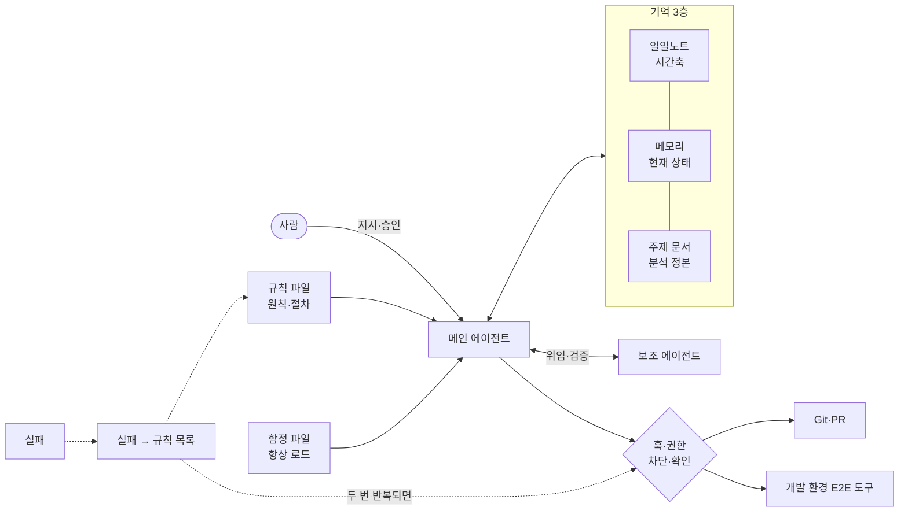

# 제가 AI 코딩 에이전트를 실무에서 쓰는 방법

> 운영 중인 백엔드를 맡으면서 AI 코딩 에이전트(Claude Code, Codex)에게 **무엇을 맡기고 무엇을 직접 결정하는지**, 제가 실제로 일하는 방식을 외부에 공유하려고 정리했습니다.
> 다루는 것은 "어떻게 일하는가"입니다. 실제 코드는 일부러 넣지 않았고, 효과를 수치로 내세우지도 않았습니다. 대신 일하면서 부딪힌 실패와, 그 뒤에 바꾼 원칙·절차·안전장치·기억 체계·멀티 에이전트 협업 방식을 **이유와 함께** 적었습니다.
> 정답이나 모범 사례를 제시하려는 것은 아닙니다. 비슷한 고민을 하는 분께 참고가 되면 좋겠습니다.

*How I work with AI coding agents (Claude Code, Codex) on a production backend — what I delegate, what I decide myself, and the principles, procedures, guardrails, memory design and multi-agent setup I ended up with, each with the failure that created it. The implementation code is intentionally left out, and I don't claim results in numbers — the focus is how I work and why.*

---

## 시작은 이런 문제들이었습니다

에이전트에게 일을 맡기니 처음엔 빨랐습니다. 그러다 같은 종류의 실수가 반복됐습니다.

- 에이전트가 검색 결과 0건을 근거로 "그런 로직은 없다"고 단정했습니다. 실제로는 다른 이름이나 다른 레이어에 있었습니다.
- 인덱스 근거가 없는 운영 DB 쿼리를 넘겼습니다. 규칙 문서에 주의를 적어 두고도 세 번 반복됐습니다.
- 남의 손에 넘긴 일을 "하기로 했다"는 말만 듣고 완료로 적었습니다. 그래서 실제 반영을 놓쳤습니다.
- 세션이 바뀌면 맥락이 끊겼습니다. 결정을 다시 묻고, 이미 닫은 안건을 다시 열었습니다.

여기 담은 것은 제가 이런 실패를 하나씩 **규칙 → 절차 → 기계적 강제** 순서로 끌어올려 온 기록입니다.

## 써 보며 배운 것

1. **규칙을 적어 두는 것만으로는 지켜지지 않았습니다.** "부재를 근거로 단정하지 말 것"이라는 규칙을 만든 달에도 같은 유형이 열 번 넘게 나왔습니다. 그래서 같은 실수가 두 번 나오면 문구를 더 쓰지 않고 훅·스크립트·스킬 단계로 올리는 것을 원칙으로 삼았습니다. 실제로 올린 것은 운영 쿼리 점검·전체 스테이징 차단·PR 처리 등 일부이고, 나머지는 아직 문구 수준입니다.
2. **승인은 '무엇이 밖으로 나가느냐'로 나눕니다.** 로컬 작업은 에이전트에 맡기고, 커밋·푸시·PR·DB 쓰기·외부 전송만 제가 승인합니다. 승인 단위도 정해 두었습니다. 개발 환경 테스트는 제 실행 지시가 그 회차 전체의 승인입니다([승인 경계 §8](01_principles/02_approval-boundary.md)). 모든 걸 승인 대기로 걸면 제가 자리를 비운 동안 아무 일도 진행되지 않습니다.
3. **상태를 담는 곳은 두 군데뿐입니다.** 같은 상태를 여러 문서에 적으면 하나만 갱신되고 나머지는 거짓이 됩니다. 기억 체계는 일일노트(시간축)·메모리(현재 상태)·주제 문서(분석 정본) 3층으로 나눴습니다.
4. **사람과 에이전트의 분업은 계속 옮겨 갑니다.** 개발 환경 조회·쓰기와 화면 테스트는 단계적으로 에이전트에 넘겼고, 대신 전용 도구·감사 로그·되돌리기를 붙였습니다. 운영 데이터 쓰기와 커밋·푸시 승인은 끝까지 제 몫으로 남겼습니다([변천](10_timeline.md)).

### 도움이 된 점

- 운영 쿼리는 문서에 쓰는 순간 점검 훅이 돌아, 진입 인덱스 근거가 없는 쿼리는 넘기기 전에 걸리게 됐습니다. 문구로만 두었을 때 세 번 반복된 실수였습니다.
- 세션이 바뀌어도 맥락이 이어졌습니다. 진행 상태와 이미 내린 결정을 매번 다시 설명하지 않아도 됐습니다.
- 자리를 비운 동안에도 로컬 작업이 진행됐습니다. 승인이 필요한 것만 모아서 돌아와 처리했습니다.

## 전체 구조

- **사람 → 메인 에이전트**: 제가 지시하고 승인합니다. 메인 에이전트는 보조 에이전트에 일을 나눠 주고 결과를 검증합니다.
- **매 세션 읽는 것**: 규칙 파일(원칙·절차), 항상 로드되는 함정 파일, 기억 3층(일일노트 = 시간축 · 메모리 = 현재 상태 · 주제 문서 = 분석 정본)
- **밖으로 나가는 행위**: 훅·권한이 차단하거나 확인을 받은 뒤에 Git·PR, 개발 환경 E2E 도구로 갑니다.
- **개선 루프**: 실패 → 「실패 → 규칙」 목록 → 규칙 파일. 같은 실수가 반복되면 훅·도구로 올려 실행 단계에서 막습니다.

그림으로 보기 (GitHub 웹에서 그려집니다)

## 무엇이 들어 있나

| 영역 | 내용 | 시작 문서 |
|---|---|---|
| 원칙 | 증거 우선, 승인 경계, 질문 매트릭스, 실행 규율, 규칙에 대한 규칙 — 18줄 요약 | [`01_principles/00_overview.md`](01_principles/00_overview.md) |
| 절차 | 세션 시작·마무리, 위임 루프, 분석·영향도, 개발 환경 검증, 운영 조회, Git·PR, 주간 개선 루프, 예약 루틴 | [`02_procedures/`](02_procedures/01_session-start-and-wrapup.md) |
| 기억 체계 | 메모리 유형 4종, 인덱스 한 줄 원칙, 크기 한도, 정리 루틴, 도메인 함정 파일 | [`03_memory-system/01_design.md`](03_memory-system/01_design.md) |
| 스킬 | 업무 보고, 개발 환경 검증, 쿼리 실행계획 점검, 메모리 정리 — 절차 문서 | [`04_skills/`](04_skills/README.md) |
| 안전장치 설계 | 커밋·푸시·운영 DB 접근을 막고 확인받는 가드 훅, SQL 점검 훅, 입력 훅 — 설계와 이유 | [`05_hooks-and-scripts/`](05_hooks-and-scripts/README.md) |
| 직접 만든 도구 | 개발 환경 E2E 자동화, 레포 횡단 참조 조회 — 왜·어떻게 만들고 평가했나 | [`06_tools-catalog/`](06_tools-catalog/README.md) |
| 멀티 에이전트 | 두 에이전트의 역할 분담, 승인 전달, 메시징, 실제로 부딪힌 실패 | [`07_multi-agent/`](07_multi-agent/01_collaboration-rules.md) |
| 소통 | 보고 형식, 상태 표기(✅/⏳), 대신 쓰는 글의 톤, 쿼리 전달 형식 | [`08_communication/`](08_communication/01_reporting-format.md) |
| 실패 → 규칙 | 실제로 겪은 실패와 그 뒤에 생긴 규칙, 강제 수준(문구·스킬·훅·도구) | [`09_lessons-learned.md`](09_lessons-learned.md) |
| 변천 | 무엇을 어떤 순서로 도입했나 — 규칙 파일에서 훅·전용 도구까지 | [`10_timeline.md`](10_timeline.md) |
| 템플릿 | 규칙 파일, 메모리, 일일노트, TC 문서, 위임 프롬프트, 예약 루틴 프롬프트 | [`templates/`](templates/) |

## 처음 보신다면

0. **사례 하나로 맛보기** — 에이전트가 무거운 운영 쿼리를 넘기는 실수가 세 번 반복됐습니다([실패 → 규칙 §2](09_lessons-learned.md#2-운영-조회)). 규칙은 이미 적혀 있었기 때문에, 넘기기 전 점검을 [운영 조회 절차](02_procedures/06_prod-query-loop.md)의 고정 형식으로 만들고, 쿼리를 문서에 쓰는 순간 점검 훅이 돌게 했습니다([안전장치 설계](05_hooks-and-scripts/README.md)).
1. [원칙 한 장 요약](01_principles/00_overview.md) — 5분
2. [실패 → 규칙 목록](09_lessons-learned.md) — 자기 환경에서 겪은 실패와 겹치는 줄부터 보시면 빠릅니다
3. 겹친 줄의 상세 문서와 템플릿
4. [변천](10_timeline.md) — 어떤 순서로 도입했는지

## 참고해서 쓰시려면

- `templates/CLAUDE.template.md`·`AGENTS.template.md`는 에이전트 규칙 파일의 템플릿입니다. 저는 워크스페이스 루트에 `CLAUDE.md`·`AGENTS.md`로 두고 씁니다. 가져다 쓰신다면 `<…>` 자리표시자를 채우고, 아직 겪지 않은 실패에 대한 줄은 지워도 괜찮습니다.
  - 파일 이름에 `.template`을 붙인 것은, 이 저장소 안에서 에이전트를 실행해도 규칙으로 읽히지 않게 하려는 것입니다.
- 저는 규칙을 미리 쌓지 않고, 실패를 겪을 때마다 한 줄씩 더했습니다. [피드백 카탈로그](03_memory-system/04_feedback-catalog.md)는 그렇게 모인 줄을 "이런 실패가 나면 이 줄을 옮긴다"는 형태로 정리한 것입니다.
- 제가 쓰는 환경은 다음과 같습니다. 다른 환경이면 "절차와 이유"는 그대로 쓰고 "명령과 경로"만 바꾸면 됩니다.
  - 여러 레포가 한 워크스페이스에 있고, 관계형 DB(PostgreSQL 계열)와 저장 프로시저·배치가 많은 백엔드
  - Windows + Git Bash/PowerShell

## 참고

- **코드는 일부러 넣지 않았습니다.** 훅·스크립트·도구는 무엇을 막거나 돕는지, 왜 그렇게 설계했는지만 남겼습니다.
- 특정 조직의 업무 내용, 시스템 이름, 데이터, 사람은 전부 뺐습니다. 예시의 테이블·코드·이름은 지어낸 것이고, 폴더 구성과 메모리 파일 이름은 실제로 쓰던 형태입니다.
- 위임 역할(구현·설계 검토·검증 에이전트)에는 오케스트레이션 플러그인 oh-my-claudecode를 활용했습니다. 제3자의 코드나 문서는 복사하지 않았습니다.

## 라이선스

[CC BY 4.0](LICENSE) · © 2026 krBang — 출처를 밝히면 자유롭게 복사·수정·재배포할 수 있습니다.
